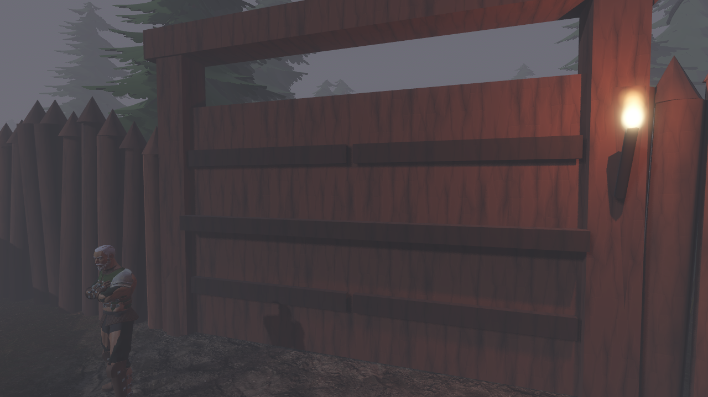
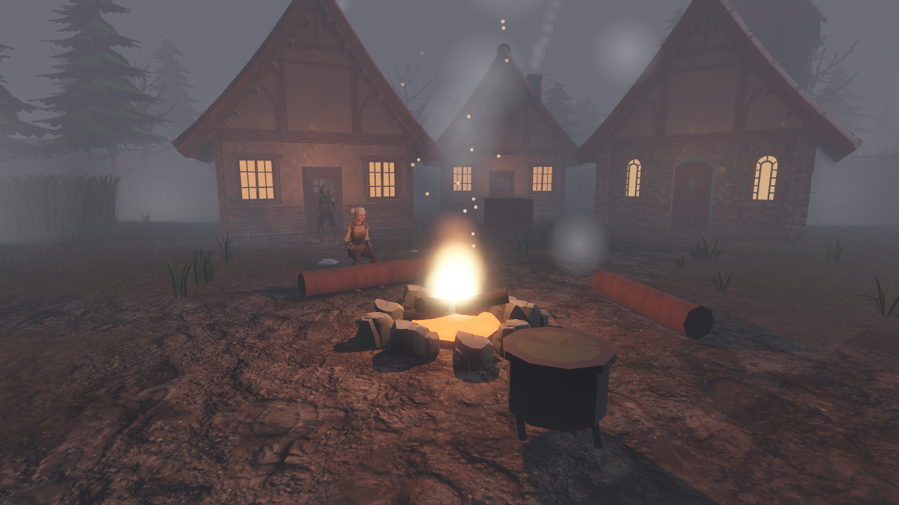
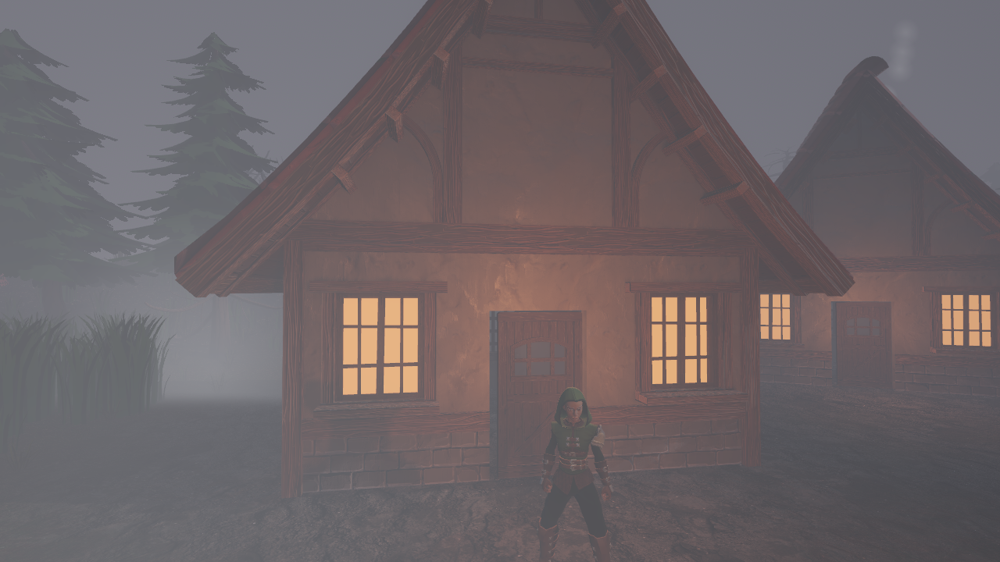
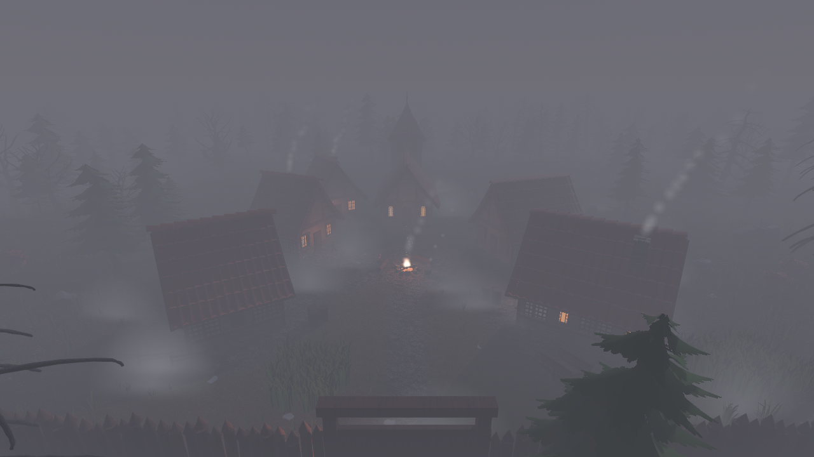
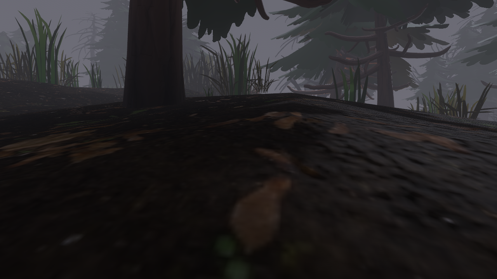
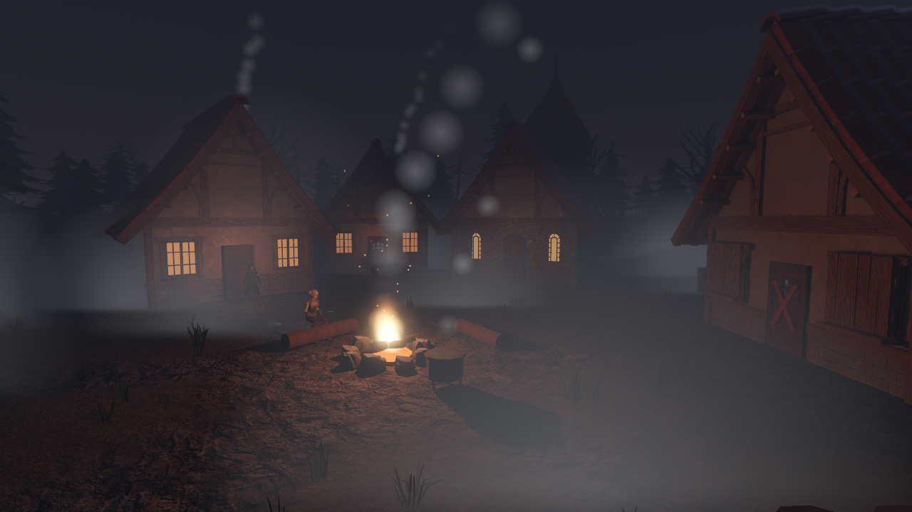

# Серый Брод — визуальный проход

## Как снимать

```
cd GreyFord
godot --path . res://tools/capture.tscn -- --tag=before    # или --tag=after
```

Скрипт `tools/capture.gd` ставит камеру в 6 точек (ворота, костёр, дом с окнами,
общий план, лес, ночь), прячет HUD и сохраняет `docs/shots/<tag>/NN_name.png`.
В сценах «костёр», «общий план», «лес» он 4 секунды меряет FPS и пишет `fps.txt`.

## Шаг 1. База («до»)

Снято в Forward+ (облачный контейнер, программный рендер llvmpipe/lavapipe).

| | |
|---|---|
|  |  |
| 01 ворота | 02 костёр |
|  |  |
| 03 дом с окнами | 04 общий план |
|  |  |
| 05 лес | 06 ночь |

**FPS** (`shots/before/fps.txt`): костёр 0.4, общий план 0.3, лес 0.6 — это программный
рендер без видеокарты, цифры ничего не говорят о реальной игре. Настоящие FPS нужно
снять на своём компьютере: `godot --path GreyFord res://tools/capture.tscn -- --tag=before`.

**Что видно:**
- Forward+ заметно темнее и туманнее, чем Compatibility (вся прошлая настройка света
  делалась в Compatibility): серая пелена съедает средний план.
- Общий план выцветший, мало контраста между домами, землёй и небом.
- Лес вблизи слишком тёмный, травы-подсказки теряются.
- Дым из CPU-частиц выглядит молочными пятнами.
- Ночь читается нормально: окна и костёр работают.

